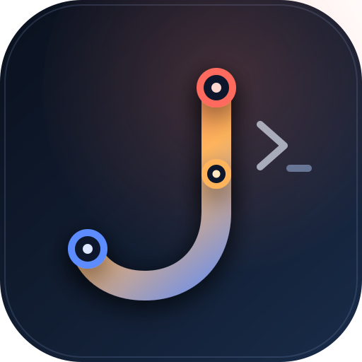

<p align="center">
  
</p>

# dsh-jenkins-panel

面向 Jenkins 的 [DeepSeek Harness](https://www.deepseek.com) (dsh) 插件：让 dsh 里的 AI 直接触发、跟踪、排查 Jenkins 构建，并提供一个 dsh 官方右侧栏可视化面板。

> DeepSeek Harness (dsh) plugin for Jenkins: AI-invocable `jenkins_*` tools, a panel on the dsh official right-sidebar, connection & token settings card, and automatic build-failure analysis pushed back into the triggering session.

## 功能

- **AI 工具（host 半）**：22 个 `jenkins_*` 工具对模型可见——构建触发/状态/日志/历史/产物、任务搜索与智能解析（多候选停下询问）、队列/工作空间/连接测试等；触发成功自动写入触发记录注册表（持久化，跨重启保留）。
- **右侧栏面板（client 半）**：接入 dsh 官方右侧栏，含总览（对话触发的构建记录 + 状态过滤实时刷新）、任务（多连接切换 + 多层级折叠树 + 搜索）、构建详情（日志 tail/分段/自动跟随、产物下载、工作空间清理、取消 / 强制终止）。
- **失败自动分析**：对话触发的构建失败（FAILURE）后，自动向触发会话回推一条分析任务书，由会话内 AI 只读排查日志并输出结构化失败总结（结论 / 关键报错 / 可能原因 / 修复建议）。可在配置中关闭。
- **构建完成主动通知**：插件触发的构建成功后默认主动回推触发会话一条短通知（任务、应用、版本、耗时、链接），模型可直接结束 turn，无需 sleep/轮询；`notify=false` 可对单次触发关闭。失败默认仍走自动分析，避免重复唤醒。
- **触发元信息**：`jenkins_build_trigger` / `jenkins_build_retry` 立即返回 `triggerId`、`queueId`、`queueUrl`、`jobName`、`status` 和脱敏后的参数，模型不再为了拿构建链接而轮询。
- **连接与凭据**：多 Jenkins 连接管理走 dsh 官方设置页分区；每连接 Token 存 dsh 凭据服务（credential-ref），明文不落配置。
- **插件页配置（dsh 0.2.0+）**：在 dsh 插件管理页可直接查看并配置本插件（`plugins.bundle.config` / `plugins.row.config` 槽位）——连接管理、默认连接、失败自动分析开关，与设置页卡片同源同款；配置持久化到 profile patch（经宿主 ConfigEditor 校验/持久化）。

## 安装

前置：dsh 0.2.0-rc.2+（web profile）。适配 dsh 0.2.0-rc.2（`next` dist-tag）；peer 范围 `^0.2.0-rc.2`，**不再兼容 0.1.x**。安装/升级时请显式指定版本（`@0.2.0-rc.2` 或 `@next`），勿依赖 `latest` 标签（当前异常，停在 0.0.1-rc.1）。

```sh
# npm 发布版（推荐，构建产物随包分发）
dsh plugin --profile <name> add dsh-jenkins-panel@<version>
```

也可以直接从 GitHub 安装（仓库内 `prepare` 脚本会在安装时自动构建）：

```sh
npm install github:developerdh/dsh-jenkins-panel
```

每次版本发布（`v*` tag）会由 CI 自动构建并挂到 [Releases](https://github.com/developerdh/dsh-jenkins-panel/releases)，可下载 `dsh-jenkins-panel-<版本>.tgz` 后 `npm install <tgz 路径>` 安装。

安装后在 dsh 设置页「Jenkins 连接」分区配置连接（URL/用户名/超时）与每连接 Token，重载页面即可在右侧栏页签中打开面板。

## 配置速览

| 配置段 | 默认值 | 说明 |
|---|---|---|
| `defaultConnection` | `default` | 缺省连接名 |
| `connections` | `[]` | 连接清单（name/url/username/timeout；name 参与凭据 ref 派生，需唯一） |
| `registry.maxPerSession` | `200` | 每会话保留的触发记录条数 |
| `registry.ttlDays` | `30` | 触发记录保留天数 |
| `registry.pollIntervalMs` | `15000` | 在途构建状态轮询间隔 |
| `analysis.enabled` | `true` | 构建失败自动分析总开关（含常驻轮询） |
| `analysis.tailLines` | `100` | 分析任务书建议的首拉日志行数 |
| `notifications.enabled` | `true` | 构建完成主动通知总开关 |
| `notifications.onSuccess` | `true` | 成功构建回推通知 |
| `notifications.onFailure` | `false` | 失败回推（默认走 analysis，避免双唤醒） |
| `notifications.onAborted` | `false` | 取消构建回推 |
| `notifications.onStarted` | `true` | 排队超过阈值后回推构建开始 |
| `notifications.startedThresholdMs` | `30000` | 开始通知的排队阈值 |
| `notifications.debounceMs` | `2000` | 同一会话内多构建完成通知的合并窗口 |

## 触发与通知行为

- 触发工具**恒不等待**，返回后模型应直接结束当前 turn；
- 普通构建只发一条完成通知；
- 排队超过 `startedThresholdMs`（默认 30s）才补一条「构建已开始」通知；
- 失败默认由 `analysis` 任务书处理：模型只读查日志，给出「建议重试 / 不建议重试」；**只有用户明确要求才执行 retry，不自动连续重试**；
- 通知只回触发它的 DSH Session，不发飞书群；
- 会话离线时跳过并记日志；
- Jenkins 卡住的步骤：先 `/stop`，无效时面板「强制终止」走 `/kill`；
- 通知发送失败重试、离线补投、排队位置通知尚未实现，见 [开发计划](./docs/development-plan.md)。

## 取消构建

Jenkins 的取消不是“立即终止”，分三层：

| 方式 | Jenkins 端点 | 行为 |
|---|---|---|
| 取消 | `POST .../stop` | 请求中断；Pipeline 会等当前步骤返回，卡住的 Docker/nuitka 步骤可能一直不结束 |
| 强制终止（工具） | `POST .../term` | 强制终止当前运行步骤，仍可能留下等待清理的 Pipeline |
| 强制终止（面板） | `POST .../kill` | 硬杀整条 Pipeline；最有效，也最彻底，请确认后再用 |

- 面板运行中会同时显示「取消」和「强制终止」；
- 「取消」走 `/stop`，提示“若 30 秒后仍在运行，可强制终止”；
- 「强制终止」走 `/kill`，用于 `/stop` 后仍卡住的构建；
- 工具 `jenkins_build_cancel` 支持 `mode: stop | term | kill`，默认 `stop`；
- 排队中的构建走取消排队，不涉及 stop/kill。

## 本地开发

```sh
pnpm install
pnpm build      # host 半（tsup）+ client 半（esbuild → ModuleLoader 协议产物）
pnpm test       # vitest 单测
pnpm lint       # eslint
pnpm typecheck  # tsc 双 tsconfig
```

挂载调试：`cordis.patch.yml` 向 profile 组合插入本插件（`dsh web --patch ./cordis.patch.yml`）。

## 开发计划与已知边界

- [开发计划](./docs/development-plan.md)
- 已知缺口：通知投递重试、离线补投、排队位置通知、通知配置 UI、Jenkins CSRF crumb、手动构建跟踪。
- 通知投递重试只重发消息，绝不重跑构建。

## 商标与归属

- **Jenkins®** 是 [LF Charities, Inc.](https://www.linuxfoundation.org/)（Linux Foundation 关联非营利机构）的注册商标。
- 本插件为独立的第三方工具，与 Jenkins 官方项目及 LF Charities 无隶属或背书关系；名称与图标仅用于指示对 Jenkins 的兼容与集成。
- 插件内使用的 Jenkins 图标取自 [jenkins.io](https://www.jenkins.io/) 官方资产，依据 [CC BY-SA 3.0](https://creativecommons.org/licenses/by-sa/3.0/) 许可分发，署名 Jenkins 项目（来源：https://jenkins.io/ ）。
- `assets/logo.svg` 是本项目原创的抽象标识，不使用 Jenkins 官方头像。

## License

[MIT](./LICENSE)
